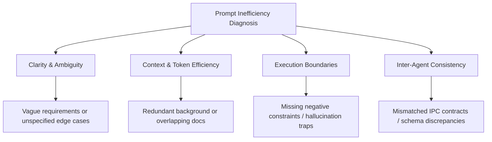
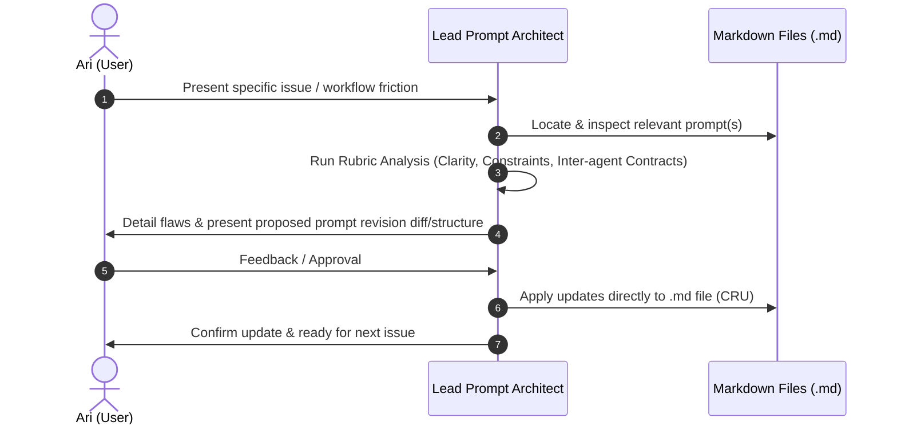

# Implementation Plan — Multi-Agent Prompt Architecture Audit & Refinement

## Goal Description
Establish an operational framework and audit rubric as the **Lead Prompt Architect and Project Planner** to diagnose, refine, and optimize the multi-agent prompt suite for the **Flux App Family** (`FluxDone` and `FluxFoxus`). 

The multi-agent prompt architecture currently spans ~63 Markdown (`.md`) specification and orchestration files across foundational context (`C1`), `FLUXDONE` (Phases 2–4), and `FLUXFOXUS` (Phases 1–4). The objective is to identify and resolve root causes of workflow inefficiencies (ambiguity, conflicting instructions, redundant context loading, loose constraints, brittle inter-agent handoffs) while strictly adhering to a zero-application-code policy.

---

## User Review Required

> [!IMPORTANT]
> **Strict Operational Boundaries:**
> 1. **Zero Code:** Under no circumstances will application code (Flutter/Dart, Android/Kotlin, SQLite, etc.) be authored, altered, or suggested.
> 2. **File Permissions (CRU):** Only Create, Read, and Update operations on Markdown (`.md`) prompt/specification files are permitted. No file deletions without explicit instruction.
> 3. **Collaborative Gating:** No `.md` file updates will be applied until the issue analysis, root cause diagnosis, and proposed revisions are reviewed and explicitly approved by you.

---

## Workspace Inventory & Prompt Topology

The directory structure breaks down into three key architectural domains:

### 1. Global Context, Design Overrides & Orchestration
- [`ff_design_override.md`](file:///home/hp/Flux_Prompts/ff_design_override.md): **Authoritative UI Override** — Replaces default FF palette with the "Rustic Medley" theme (`#13191F`, `#2B2F2E`, `#594C3D`, `#906D4B`, `#CA9C68`). Prohibits purples/blues/cyans.
- [`prompts_docx/C1/FLUX_CONTEXT.md`](file:///home/hp/Flux_Prompts/prompts_docx/C1/FLUX_CONTEXT.md): Foundational domain context, user persona (Ari), app relationship (FD ↔ FF IPC), and shared design principles.
- [`prompts_docx/C1/FLUX_SKILLS_GUIDE.md`](file:///home/hp/Flux_Prompts/prompts_docx/C1/FLUX_SKILLS_GUIDE.md): Antigravity skills CLI and repository setup instructions.
- [`prompts_docx/C1/GMP_FD_BUILD.md`](file:///home/hp/Flux_Prompts/prompts_docx/C1/GMP_FD_BUILD.md): Grand Master Prompt for building FluxDone.
- [`prompts_docx/C1/GMP_FF_BUILD.md`](file:///home/hp/Flux_Prompts/prompts_docx/C1/GMP_FF_BUILD.md): Grand Master Prompt for building FluxFoxus.

### 2. FluxDone (FD) Feature & UI Suite (`prompts_docx/FLUXDONE/`)
- **Phase 1 Foundation (.docx & .txt specs):**
  - [`prompts_docx/FLUXDONE/Phase 1/FluxDone_PRD.docx`](file:///home/hp/Flux_Prompts/prompts_docx/FLUXDONE/Phase%201/FluxDone_PRD.docx) & [`FluxDone_TRD.docx`](file:///home/hp/Flux_Prompts/prompts_docx/FLUXDONE/Phase%201/FluxDone_TRD.docx)
  - Root text references: [`FluxDone_PRD_v2.txt`](file:///home/hp/Flux_Prompts/FluxDone_PRD_v2.txt) & [`FluxDone_TRD_v2.txt`](file:///home/hp/Flux_Prompts/FluxDone_TRD_v2.txt)
- **Phase 2 (11 .md files + v2 docx):** UI screen specs (`ui_SCR-02` through `ui_SCR-13`), icon systems (`ui_ICONS_icon-system.md`), and backup/status amendments (`FD_P2_AMENDMENT_*`).
- **Phase 3 (11 files):** Custom theming (`FD_P3_F1`), widgets amendments (`FD_P3_F2_*`), import/export (`FD_P3_F3`, `FD_P3_F4`), notes (`FD_P3_F6`), and subtask views.
- **Phase 4 (8 files):** Focus overlap warnings (`FD_P4_F1`), statistics (`FD_P4_F2`), NLP task parsing (`FD_P4_F3`), task templates (`FD_P4_F4`), multiselect bulk timeshift (`FD_P4_F5`), linked tasks (`FD_P4_F6`).

### 3. FluxFoxus (FF) Discipline Suite (`prompts_docx/FLUXFOXUS/`)
- **Phase 1 (12 files):** PRD/TRD v1.0, core UI specs (`ui_home.md`, `ui_preset.md`, `ui_focus_session.md`, `ui_app_limits.md`, `ui_distracted_intervention.md`, `ui_planner.md`, `ui_usage_stats.md`, `ui_navigation.md`, `ui_widget.md`, `ui_design_system.md`).
- **Phase 2 (5 files):** Uninstall protection, scheduled sessions, AI break negotiation, streak grace, post-session reflection.
- **Phase 3 (5 files):** Focus score, session templates/auto-scheduling, lock screen status, AI improvements, bug fixes/polish.
- **Phase 4 (7 files):** Focus score enhancement, pre-open friction, category limits, app limit smart suggestions, multi-device sync protocols (i, ii, iii).

---

## Architectural Review Rubric

When analyzing prompts for workflow inefficiencies, each prompt will be evaluated against:

1. **Clarity & Determinism:** Are instructions explicit, actionable, and unambiguous? Does the prompt leave room for agent improvisation where strict adherence is required?
2. **Context & Token Economy:** Does the prompt overload the agent's context window with irrelevant background, or fail to provide mandatory references?
3. **Negative Constraints & Guardrails:** Are "Do Not" rules explicit? Does the agent have strict stopping conditions and error handling?
4. **Interface & Contract Alignment:** Do cross-app specifications (e.g., FD ↔ FF MethodChannel IPC contracts) match exact field names, types, and error states across files?
5. **Modularity vs. Monolithic Bloat:** Can tasks be executed independently without requiring massive multi-phase context loading?

---

## Operational Workflow

---

## Verification Plan

### Manual Verification
- For each file revised, verify that all references to other prompt files, data schemas, and UI specifications remain internally consistent.
- Ensure formatting adheres strictly to Markdown standards with clean headings, tables, code fences, and alerts.
- Confirm zero non-markdown modifications have occurred across the workspace.
