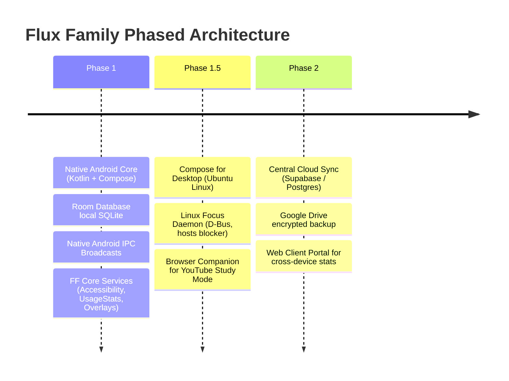

# Flux App Family — System Context Document (v2.0)

**Version:** 2.0 (Kotlin + Jetpack Compose Architecture)  
**Date:** March 2026 / v2 Overhaul  
**Author:** Ari  
**Target Environment:** Android (Mobile) + Ubuntu Linux (Desktop Workstation)

---

## 1. Purpose of This Document

This is the foundational context document for the **Flux App Family**. It defines:
- Who is building the apps and their operational hardware environment.
- The architectural pivot from Flutter/Dart to **Native Kotlin + Jetpack Compose**.
- The relationship, boundaries, and communication contracts between the companion apps.
- Core design principles, offline-first data structures, and phased multi-device sync roadmap.

This document serves as the master anchor for AI coding agents (Antigravity/Claude) and human planners. It must be loaded first in any session before reading feature specifications.

---

## 2. Who Is Building This & Hardware Environment

### The Builder: Ari
**Ari** is an intensive student balancing:
- **Math Olympiad:** IOQM → INMO → IMO track
- **JEE Foundation:** Neev Diamond batch at Physics Wallah (Physics, Chemistry, Mathematics)
- **School Curriculum:** ICSE Class 10 → 12
- **Software Architecture:** Directs autonomous AI coding agents to build tools tailored to his exact cognitive and academic workflows. Ari defines architectures, data contracts, and UI constraints, while delegating 100% of code authoring and execution to AI agents.

### Operational Hardware & Platform Topology
1. **Primary Mobile Device:** Android Smartphone (Targeting API 26+ up to API 34+). This is where daily on-the-go task capture and screen time enforcement take place.
2. **Primary Desktop Workstation:** Laptop running **Ubuntu Linux (LTS)**. This is where deep study sessions, lecture viewing (PW Neev Diamond), Olympiad problem-solving, and AI agent coordination take place.

---

## 3. The Flux App Family Overview

The Flux Family consists of two complementary, deeply coordinated, but independently executable applications:

| Application | Replaces | Abbreviation | Primary Role | Core Stack |
| :--- | :--- | :--- | :--- | :--- |
| **FluxDone** | TickTick | **FD** | Task & Habit Management, Academic Timeline Time-Blocking | Kotlin + Jetpack Compose (Android) & Compose Desktop (Ubuntu) |
| **FluxFoxus** | Regain | **FF** | Screen Discipline, App Enforcement, Focus Timers, Friction Systems | Native Android Kotlin (System Enforcer) & Ubuntu Linux Daemon (Compose Desktop) |

### The Core Architectural Principles:
1. **Zero-Code Planners:** Prompt architects and planning sessions do not write application code; they author, audit, and refine deterministic markdown specifications.
2. **Two Separate Apps (Decoupled Packages):** FD (`com.fluxdone`) and FF (`com.fluxfoxus`) are separate application packages. They can be installed, updated, launched, or used independently.
3. **Offline-First Storage:** Every core feature functions with zero internet connection. Data is stored locally in SQLite via Android Room Database on mobile and SQLite / SQLDelight on Ubuntu Desktop.
4. **Phased Evolution:**
   - **Phase 1 (Native Local Core):** 100% offline-first Android apps + Ubuntu Desktop builds. Direct local IPC on Android.
   - **Phase 1.5 (Ubuntu Desktop Companions):** Compose for Desktop apps on Ubuntu sharing core Kotlin domain logic.
   - **Phase 2 (Central Database & Web Access):** Central cloud database (Supabase / PostgreSQL) for seamless bidirectional sync between Android and Ubuntu, plus a lightweight web dashboard for browser access.

---

## 4. Why We Pivoted: From Flutter/Dart to Native Kotlin + Jetpack Compose

The initial prototype attempted to build Flux using Flutter and Dart. That architecture was permanently decommissioned due to fatal friction points:
1. **The System-Enforcer Trap in FF:** FluxFoxus is not a simple UI canvas. It requires deep Android OS APIs: `UsageStatsManager`, `AccessibilityService`, `SYSTEM_ALERT_WINDOW` overlays, `DevicePolicyManager`, and foreground services. Flutter cannot access these natively, resulting in brittle third-party plugins, Gradle version mismatches, and headless engine battery drain.
2. **The IPC Fallacy:** Flutter `MethodChannel` cannot communicate between two separate applications. Android inter-app IPC requires native OS primitives.
3. **Elimination of `build_runner`:** Flutter required fragile code generation (`freezed`, `json_serializable`, `riverpod_generator`) that frequently broke multi-agent loops. Kotlin provides native `data class`, `kotlinx.serialization`, Coroutines, and `StateFlow` with zero code-gen fragility.
4. **Desktop Native Parity:** Jetpack Compose shares 100% of its UI paradigm and business logic with **Compose Multiplatform for Desktop**, running natively on Ubuntu Linux with zero web-engine overhead.

---

## 5. FluxDone (FD) — Task & Habit Management

### Purpose & Persona Alignment
FD completely replaces TickTick. It is designed to minimize cognitive friction during heavy academic schedules.

### What Ari Actually Uses:
- **Lists and Folders:** Categorized academic and life buckets.
- **Sections Inside Lists:** Dividing subjects into clear sub-modules (e.g., Neev Diamond divided into Physics, Chemistry, Math).
- **The Calendar View (Primary Task Creation Surface):** Ari does not use the calendar as a passive agenda viewer. He opens the timeline, spots available gaps, and **taps the timeline to create a task with immediate start and end times**. The calendar UI must be optimized for rapid creation gestures.
- **Smart Lists:** Today, Tomorrow, All, Completed, Trash.
- **Recurring Tasks:** Daily, weekly, interval-based recurrence rules.
- **Habits Tracker:** Daily streak check-offs with target counts.
- **Academic Color System (System-Locked):**
  
  | Domain | Hex Code | Purpose |
  | :--- | :--- | :--- |
  | **Number Theory** | `#2E7D32` | Math Olympiad domain |
  | **Geometry** | `#1565C0` | Math Olympiad domain |
  | **Combinatorics** | `#43A047` | Math Olympiad domain |
  | **Algebra P1** | `#FB8C00` | Math Olympiad domain |
  | **Algebra P2** | `#E64A19` | Math Olympiad domain |
  | **Tests** | `#E53935` | Mock exams & tests |
  | **Neev Diamond** | `#576481` | PW JEE Foundation batch |

  *All other personal lists use custom user-selected colors.*

---

## 6. FluxFoxus (FF) — Screen Discipline & Focus

### Purpose & Persona Alignment
FF completely replaces Regain. It is not a gentle "wellness" app; it is an **enforcement and tracking tool** built around deliberate friction mechanics.

### Core Concepts & Mechanics:
- **Presets:** Reusable focus configurations that specify:
  - Break count (0–6 breaks)
  - Break duration (1–15 minutes each)
  - Per-app restrictions (Blocked, Allowed, Whitelisted)
  - YouTube Study Mode (Block, Allow, or Strict Whitelist)
  - Presets are applied to sessions on demand; they do not dictate session start times.
- **The Focus Timer:** Mechanical flip-clock design (HH:MM). Supports Countdown, Stopwatch, and Open-Ended modes. Full-screen immersive takeover during active sessions.
- **Stop Focusing Modal:** To prevent impulsive session quits, both dialog buttons (*"Keep Going"* and *"Quit Session"*) are locked and disabled for 15–25 seconds. The delay is mathematically calculated based on streak count and today's distraction time.
- **Intervention Overlays (5 / 10 / 20 / 40 min):** When a marked distracting app is opened outside a scheduled focus session, a system overlay appears forcing the user to pick an intentional usage window. Once expired, access is blocked.
- **YouTube Study Mode:** Only whitelisted academic channels are allowed. Attempting to view non-whitelisted videos requires typing friction sentences (5 short sentences initially, scaling to 50 longer sentences).
- **Authoritative UI Theme: Holst (Холст):**
  Strictly governed by the design override sourced from `Theme/Холст.jpeg`:
  - Background: `#0D1B2A` (Abyssal Navy)
  - Surface: `#1B263B` (Oxford Slate)
  - Border / Dividers: `#415A77` (Muted Steel Blue)
  - Accent / Breaks: `#778D7A` (Muted Sage Green)
  - Primary / Action: `#D4C4A8` (Warm Sand Khaki)
  - Text Primary: `#F4F1DE` (Eggshell Cream)
  - Text Muted: `#8E9CAE` (Slate Blue-Grey)

---

## 7. Ubuntu Linux Companion Specifications

### FluxFoxus on Ubuntu (Linux Focus Daemon)
To protect focus while Ari works on his Ubuntu laptop:
1. **Focus Engine Daemon:** A lightweight background service (systemd user service) running on Ubuntu:
   - Tracks active window focus via D-Bus / GNOME Shell / X11 / Wayland window title inspection.
   - Distraction website blocking via temporary `/etc/hosts` or local DNS sinkhole during active focus.
   - Process freeze (`SIGSTOP`) on unauthorized desktop apps during strict focus.
2. **Desktop UI & Flip Clock:** Built in **Compose for Desktop**. Provides a floating system tray icon, countdown timer, and fullscreen flip clock overlay.
3. **Browser Companion (YouTube Study Mode):** A lightweight Chrome/Firefox browser extension communicating with the local Linux daemon via Native Messaging to enforce YouTube channel whitelists.

### FluxDone on Ubuntu (Desktop Productivity)
- Built in **Compose for Desktop**, sharing 90%+ of UI and logic code with the Android app.
- Native keyboard shortcuts, full-screen calendar timeline time-blocking, and local SQLite persistence.

---

## 8. Inter-App Communication (IPC): FD ↔ FF

On Android, FluxDone and FluxFoxus communicate via **Native Android Explicit Intents and registered BroadcastReceivers**.

### Action Contract
- **Broadcast Action:** `com.flux.action.FOCUS_BLOCK_SYNC`
- **Sender Permission:** Secured via shared custom permission `com.flux.permission.SYNC_EVENT` or explicit component targeting.

### Payload Schema (JSON / Intent Bundle):
```json
{
  "version": 1,
  "timestamp": 1773324000000,
  "action": "CREATE", 
  "payload": {
    "taskId": "task_uuid_string",
    "taskName": "Solve Combinatorics Sheet 4",
    "startTime": 1773327600000,
    "endTime": 1773334800000,
    "durationMinutes": 120,
    "listId": "list_combinatorics_uuid",
    "presetId": null
  }
}
```

### Action Semantics:
- `CREATE`: When FD schedules a timed task, FF creates or reserves a linked focus session.
- `UPDATE`: When FD shifts or resizes a timeline block, FF automatically updates the linked session window.
- `DELETE`: When FD cancels or deletes a task, FF tears down the reservation.

---

## 9. Phased Delivery Roadmap



---

## 10. Rules for AI Agents Working on Flux
1. **Never generate Flutter or Dart code.** The stack is strictly **Kotlin, Jetpack Compose, Android Jetpack, and Compose Multiplatform**.
2. **Never propose `build_runner` or custom code-gen plugins.** Use Kotlin standard tools (`kotlinx.serialization`, Room KSP, Kotlin Data Classes).
3. **Respect UI Theme Locks:** All FF screens must strictly map to the **Holst (Холст)** palette (`#0D1B2A`, `#1B263B`, `#415A77`, `#778D7A`, `#D4C4A8`, `#F4F1DE`). No unapproved purples or neon cyans. All FD academic screens must use the 7 locked academic domain hex values.
4. **Offline First is Non-Negotiable:** Local Room SQLite database operations must never fail due to network absence.
