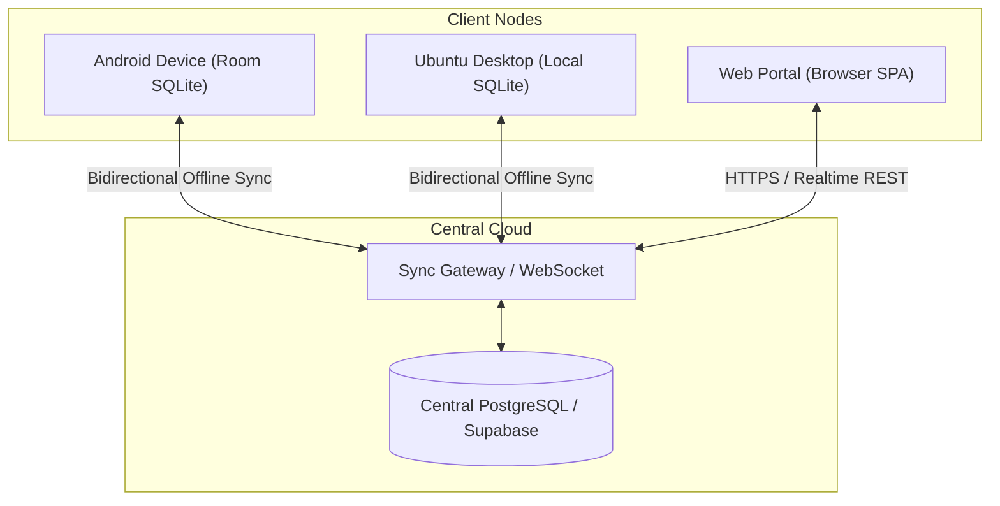

# Flux Family — Central Database Sync & Web Portal Roadmap (v2.0)

**Version:** 2.0  
**Phase:** Phase 2 (Post-Phase 1 Local Core)  
**Target Capabilities:** Android Phone ↔ Ubuntu Desktop Multi-Device Sync + Lightweight Web Dashboard  
**Architecture:** Offline-First Local Storage (Room/SQLite) + Cloud Sync Gateway (Supabase / PostgreSQL)

---

## 1. Architectural Strategy

Flux is strictly **offline-first**. All features in Phase 1 function with zero internet dependency. 

In Phase 2, a **Central Database Sync Engine** is introduced to:
1. Seamlessly mirror tasks and calendar blocks between Ari's **Android phone** and **Ubuntu laptop**.
2. Aggregate focus sessions and screen discipline statistics across both devices.
3. Provide a **responsive Web Portal** so users without the desktop app can manage tasks, view schedules, and inspect discipline analytics from any browser.



---

## 2. Central Schema Design (PostgreSQL / Supabase)

To enable robust offline synchronization, all tables enforce:
- **UUID Primary Keys:** Generated on the client device at creation time (no auto-increment integer ID conflicts).
- **Soft Deletes:** Rows are flagged with `is_deleted = TRUE` rather than removed, ensuring delete operations propagate across devices.
- **Monotonic Timestamps:** `updated_at_utc` recorded as 64-bit UTC epoch milliseconds.

### 2.1 Core Relational Tables
```sql
-- FluxDone: Tasks
CREATE TABLE tasks (
    id UUID PRIMARY KEY,
    user_id UUID NOT NULL,
    title TEXT NOT NULL,
    notes TEXT,
    list_id UUID NOT NULL,
    section_id UUID,
    start_time_utc BIGINT,
    end_time_utc BIGINT,
    is_completed BOOLEAN NOT NULL DEFAULT FALSE,
    completed_at_utc BIGINT,
    recurrence_rule TEXT,
    priority INT NOT NULL DEFAULT 0,
    is_deleted BOOLEAN NOT NULL DEFAULT FALSE,
    updated_at_utc BIGINT NOT NULL
);

-- FluxDone: Academic & Custom Lists
CREATE TABLE lists (
    id UUID PRIMARY KEY,
    user_id UUID NOT NULL,
    name TEXT NOT NULL,
    color_hex TEXT NOT NULL,
    is_domain_locked BOOLEAN NOT NULL DEFAULT FALSE,
    sort_order INT NOT NULL DEFAULT 0,
    is_deleted BOOLEAN NOT NULL DEFAULT FALSE,
    updated_at_utc BIGINT NOT NULL
);

-- FluxFoxus: Focus Sessions (Mobile & Desktop Combined)
CREATE TABLE focus_sessions (
    id UUID PRIMARY KEY,
    user_id UUID NOT NULL,
    device_type TEXT NOT NULL, -- 'ANDROID' or 'UBUNTU_DESKTOP'
    preset_id UUID,
    start_time_utc BIGINT NOT NULL,
    end_time_utc BIGINT,
    duration_minutes INT NOT NULL,
    status TEXT NOT NULL,      -- 'COMPLETED', 'QUIT_PREMATURELY', 'CANCELLED'
    linked_task_id UUID,
    distraction_events INT NOT NULL DEFAULT 0,
    updated_at_utc BIGINT NOT NULL
);

-- Unified Daily Statistics
CREATE TABLE daily_focus_stats (
    id UUID PRIMARY KEY,
    user_id UUID NOT NULL,
    date_iso DATE NOT NULL,
    total_focus_minutes INT NOT NULL DEFAULT 0,
    productive_minutes INT NOT NULL DEFAULT 0,
    distracting_minutes INT NOT NULL DEFAULT 0,
    streak_count INT NOT NULL DEFAULT 0,
    updated_at_utc BIGINT NOT NULL,
    UNIQUE(user_id, date_iso)
);
```

---

## 3. Conflict Resolution & Offline Sync Protocol

### 3.1 Sync Protocol (Last-Write-Wins with Tombstones)
1. **Local Mutation Queue:** When a task or habit is edited offline, the client records the mutation in a local `sync_queue` table with the current UTC timestamp.
2. **Push Phase:** Upon reconnecting, the client batches pending mutations and sends them to the sync server.
3. **Conflict Resolution:** If the server record has a higher `updated_at_utc`, server state wins; otherwise, client mutation overwrites server state.
4. **Pull Phase:** The client queries all records modified since its `last_synced_at_utc` timestamp and updates its local Room database in a single transaction.

---

## 4. Web Portal Architecture (For Non-Desktop Users)

For users or devices without the native desktop application installed:
- **Client Framework:** Modern lightweight web application (e.g., Next.js or Compose for Web / Kotlin Wasm).
- **Features:**
  - Full Academic Calendar view with time-block editing.
  - Interactive Task List with smart views (Today, Tomorrow, Olympiad, Neev Diamond).
  - Cross-device discipline analytics (showing combined phone and desktop focus hours).
- **Design:** Consumes the exact same design tokens (`FLUX_DESIGN_TOKENS.md`), rendering high-contrast dark surfaces and locked academic domain colors in the browser.
