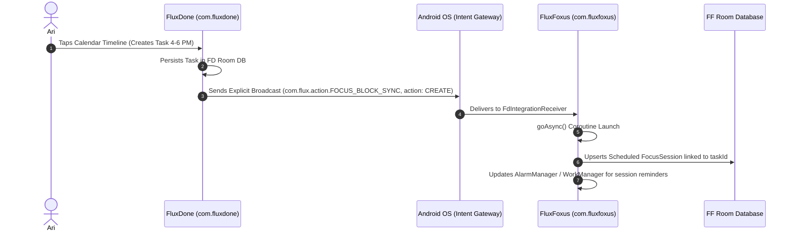

# Inter-App IPC Specification: FluxDone ↔ FluxFoxus (v2.0 Native Android)

**Version:** 2.0  
**Transport Protocol:** Android Intent & Explicit BroadcastReceiver System  
**Sender:** FluxDone (`com.fluxdone`)  
**Receiver:** FluxFoxus (`com.fluxfoxus`)  
**Security:** Explicit Component Target + Custom Signature Permission

---

## 1. Architectural Rationale

In the previous prototype, the specification attempted to use Flutter's `MethodChannel`. `MethodChannel` cannot communicate between two distinct Android APK processes. 

On Android, inter-app communication between decoupled companion applications must use native OS IPC primitives: **Explicit Intents** and **BroadcastReceivers**.

---

## 2. Intent Contract & Actions

### 2.1 Broadcast Action
- **Intent Action:** `com.flux.action.FOCUS_BLOCK_SYNC`
- **Target Package:** Explicitly locked to `com.fluxfoxus` to prevent intent interception by malicious third-party apps:
  ```kotlin
  intent.setPackage("com.fluxfoxus")
  ```

### 2.2 Security & Permissions
Both apps declare a shared custom permission in their `AndroidManifest.xml`:
```xml
<!-- Defined by FluxFoxus, used by FluxDone -->
<permission 
    android:name="com.flux.permission.FOCUS_IPC" 
    android:protectionLevel="signature" />

<uses-permission android:name="com.flux.permission.FOCUS_IPC" />
```
*(During early development/testing before shared signing keys, explicit package targeting `intent.setPackage("com.fluxfoxus")` is enforced).*

---

## 3. Data Schema & Payload Contract

All timestamps are **64-bit Long (Unix Epoch Milliseconds in UTC)**.

### 3.1 Intent Extras Bundle

| Key | Type | Mandatory? | Description |
| :--- | :--- | :--- | :--- |
| `EXTRA_VERSION` | `Int` | Yes | IPC contract version (Must be `1`). |
| `EXTRA_ACTION` | `String` | Yes | Enum: `"CREATE"`, `"UPDATE"`, `"DELETE"`. |
| `EXTRA_TASK_ID` | `String` | Yes | Unique UUID of the task from FluxDone. |
| `EXTRA_TASK_NAME` | `String` | Yes | Display title of the task (e.g., *"Geometry Sheet 2"*). |
| `EXTRA_START_TIME` | `Long` | Yes | Start timestamp in UTC milliseconds. |
| `EXTRA_END_TIME` | `Long` | Yes | End timestamp in UTC milliseconds. |
| `EXTRA_DURATION_MIN`| `Int` | Yes | Calculated duration in minutes. |
| `EXTRA_LIST_ID` | `String` | Yes | UUID of the parent list in FluxDone. |
| `EXTRA_COLOR_HEX` | `String` | No | Domain color hex code (e.g., `"#1565C0"`). |
| `EXTRA_PRESET_ID` | `String` | No | Optional linked FF preset UUID. Null defaults to last-used. |

### 3.2 JSON String Alternative Payload
For simplified logging and serialization, the entire payload is also packed into a serialized JSON string under the key `EXTRA_PAYLOAD_JSON`:

```json
{
  "version": 1,
  "action": "CREATE",
  "taskId": "7c9e6679-7425-40de-944b-e07fc1f90ae7",
  "taskName": "Olympiad Combinatorics Practice",
  "startTimeEpochMs": 1773327600000,
  "endTimeEpochMs": 1773334800000,
  "durationMinutes": 120,
  "listId": "list_combinatorics_441",
  "colorHex": "#43A047",
  "presetId": null
}
```

---

## 4. Lifecycle & Action Semantics



### 4.1 CREATE Action
- **Trigger:** Ari creates a task in FluxDone that possesses both a `start_time` and `end_time` (e.g., via calendar timeline tap).
- **FF Handling:**
  - FF queries its database for an existing session with `linked_task_id == EXTRA_TASK_ID`.
  - If none exists, FF creates a new `FocusSession` record in status `SCHEDULED`.
  - Assigns the user's default/last-used Preset configuration.
  - Schedules precise start alarm via Android `AlarmManager`.

### 4.2 UPDATE Action
- **Trigger:** Ari resizes, shifts, or renames a time-block in FluxDone.
- **FF Handling:**
  - FF locates the linked `FocusSession` by `linked_task_id`.
  - Updates `start_time`, `end_time`, and `task_name`.
  - Re-arms `AlarmManager` with updated start notifications.

### 4.3 DELETE Action
- **Trigger:** Ari deletes or marks a timed task as cancelled in FluxDone.
- **FF Handling:**
  - FF locates the linked `FocusSession`.
  - If the session is currently active, prompts user confirmation; if scheduled in the future, automatically cancels and deletes the reservation.

---

## 5. Receiver Implementation Architecture in FluxFoxus

To guarantee execution even if FluxFoxus is not currently in memory, the receiver must be declared in `AndroidManifest.xml` and utilize `goAsync()`:

```kotlin
// Conceptual Kotlin pattern for AI coding agents
class FdIntegrationReceiver : BroadcastReceiver() {
    override fun onReceive(context: Context, intent: Intent) {
        if (intent.action != "com.flux.action.FOCUS_BLOCK_SYNC") return

        val pendingResult = goAsync()
        val scope = CoroutineScope(Dispatchers.IO + SupervisorJob())

        scope.launch {
            try {
                val action = intent.getStringExtra("EXTRA_ACTION") ?: return@launch
                val taskId = intent.getStringExtra("EXTRA_TASK_ID") ?: return@launch
                // Delegate to SessionRepository to create/update/delete focus session
            } finally {
                pendingResult.finish()
            }
        }
    }
}
```

This guarantees 100% reliable inter-app synchronization with zero reliance on web servers or third-party plugins.
