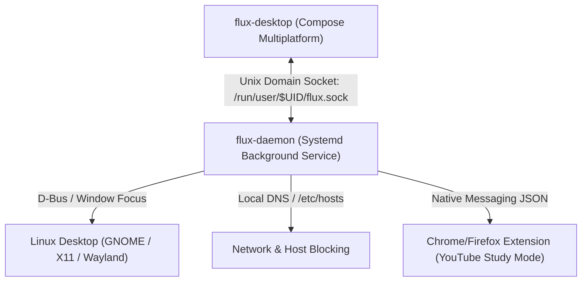

# FluxFoxus Ubuntu Linux Daemon & Desktop Specification (v2.0)

**Version:** 2.0  
**Target OS:** Ubuntu Linux (22.04 / 24.04 LTS) — GNOME Shell / Wayland / X11  
**Architecture:** Background Systemd User Service (`flux-daemon`) + Compose Desktop UI (`flux-desktop`)  
**Purpose:** Replicate FF's discipline, app blocking, and focus timer mechanics natively on Ari's Ubuntu workstation.

---

## 1. System Architecture Overview

On Ubuntu Linux, FluxFoxus is partitioned into two specialized components:
1. **`flux-daemon` (The Enforcer):** A lightweight background service running as a `systemd --user` unit. It tracks active desktop windows, manages distraction domain blocking, enforces process suspension, and communicates with browsers for YouTube Study Mode.
2. **`flux-desktop` (The UI & Timer):** A native **Compose for Desktop** application. It renders the system tray indicator, active session management, and the full-screen mechanical flip clock overlay matching the **Rustic Medley** theme.



---

## 2. Enforcement Mechanisms on Linux

### 2.1 Active Window & Application Tracking
- **Wayland / GNOME Shell:** Daemon connects to GNOME D-Bus (`org.gnome.Shell.Introspect` / window evaluation extensions) to identify the currently active window title and application ID.
- **X11 Fallback:** Uses `_NET_ACTIVE_WINDOW` via standard X11 libraries (`xdotool` / `xprop`).
- **Policy:** When a designated distracting application (e.g., Discord, Steam, games) is focused during an active focus session, the daemon immediately triggers the intervention overlay or sends a process pause.

### 2.2 Distraction Website Blocking
- **Mechanism:** During an active focus session with web restrictions enabled, the daemon diverts distracting domains (e.g., social media, entertainment sites) to `0.0.0.0`.
- **Implementation Options:**
  - *Option A (Lightweight Helper):* A small root helper script managed via `sudoers.d` that swaps `/etc/hosts` with a focus-restricted profile upon session start and restores on session finish.
  - *Option B (Local DNS Proxy):* Daemon runs a local DNS forwarder on `127.0.0.1` filtering queries based on active preset blocklists.

### 2.3 YouTube Study Mode on Desktop
- **Browser Integration:** Implemented via a lightweight WebExtension (Manifest V3 for Chrome/Brave/Firefox).
- **Communication:** Uses standard **Native Messaging** over `stdin`/`stdout`.
- **Enforcement:**
  - The extension monitors the current YouTube channel name.
  - If the channel is not on Ari's whitelist, the extension pauses playback and injects an in-page modal requiring the user to type the mandatory friction sentences before access is granted.

---

## 3. Desktop UI Experience (Compose for Desktop)

The desktop UI is built using **Compose Multiplatform (Kotlin JVM)**, sharing theme tokens and logic directly with the mobile app:

### 3.1 System Tray Integration
- Resides in the Ubuntu top bar / system tray.
- Displays remaining focus minutes (e.g., `"FF: 42m"`).
- Right-click menu for quick preset selection (*"Olympiad Math (2h)"*, *"Physics JEE (90m)"*, *"Deep Reading (45m)"*).

### 3.2 Fullscreen Mechanical Flip Clock Takeover
- When a focus session begins or when invoked via hotkey (e.g., `Super + F`), displays a full-screen borderless window on the primary monitor.
- Styled exclusively in **Rustic Medley**:
  - Background: River Styx (`#13191F`)
  - Mechanical Flaps: Carbon Fibre (`#2B2F2E`) with hairline Amber divider (`#CA9C68`)
  - Numbers: Monospace tabular Ghost White (`#F8FAFC`).
- Pressing `Esc` or clicking *"Quit Session"* triggers the **15–25 second penalty countdown** dialog before the button becomes clickable.

---

## 4. Local Inter-Process Protocol (Unix Domain Socket)

Communication between `flux-desktop` and `flux-daemon` takes place over a local Unix domain socket:
- **Socket Path:** `/run/user/$UID/fluxfoxus.sock`
- **Protocol:** Line-delimited JSON commands:
  ```json
  {"cmd": "START_SESSION", "presetId": "olympiad_math", "durationMin": 120}
  {"cmd": "REQUEST_QUIT"}
  {"cmd": "GET_STATUS"}
  ```
- **Daemon Responses:**
  ```json
  {"status": "ACTIVE", "remainingSeconds": 5420, "streakDays": 14, "breakAvailable": true}
  ```

This architecture ensures that screen discipline on Ari's Ubuntu laptop is just as robust and frictionless as on his Android phone.
