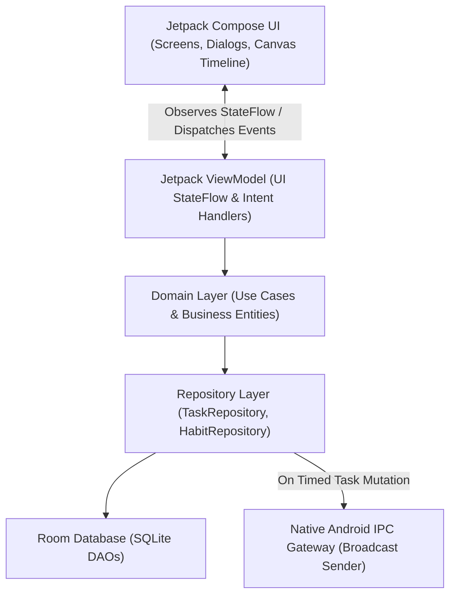

# FluxDone (FD) — Technical Requirements Document (TRD v2.0 Kotlin)

**Version:** 2.0 (Native Kotlin + Jetpack Compose Architecture)  
**Date:** March 2026 / v2 Overhaul  
**Target Platform:** Android (API 26+ / Target API 34) & Ubuntu Linux (Compose Desktop)  
**Author:** Ari

---

## 1. Technology Stack Specification

| Component | Technology | Version Guidance | Purpose |
| :--- | :--- | :--- | :--- |
| **Language** | Kotlin | 1.9.20+ / 2.0+ | Modern type safety, Coroutines, Data Classes |
| **UI Framework** | Jetpack Compose | Compose BOM (2024.x) | Declarative UI, timeline canvas drawing |
| **Architecture** | Modern Android Architecture | Google Clean Architecture | UI → ViewModel → UseCase → Repository → Room |
| **Local Storage** | Jetpack Room Database | 2.6.x (via KSP) | Offline-first SQLite database with compile-time query safety |
| **State Management** | `ViewModel` + `StateFlow` | Android Lifecycle 2.8+ | Reactive unidirectional data flow (UDF) |
| **Asynchronous** | Kotlin Coroutines & Flow | 1.8.x | Non-blocking database I/O and reactive UI streams |
| **Serialization** | `kotlinx.serialization` | 1.6.x | JSON export/import and IPC payload encoding |
| **Dependency Injection**| `Koin` or `Hilt` | Latest stable | Clean dependency injection |
| **Navigation** | `navigation-compose` | 2.7.x | Type-safe Compose navigation routes |
| **Alarms & Reminders** | `AlarmManager` & `NotificationManager` | Android Framework | Precise task due date and habit reminder heads-up |
| **Inter-App IPC** | Android `BroadcastReceiver` & `Intent` | Android Framework | Sends `com.flux.action.FOCUS_BLOCK_SYNC` to FluxFoxus |

---

## 2. System Architecture & Layer Boundaries



### Layer Rules:
1. **Presentation Layer:** Contains `@Composable` screens and ViewModels. Zero raw SQL or direct IPC calls. All UI state is modeled as immutable Kotlin `data class UiState`.
2. **Domain Layer:** Pure Kotlin business logic. Houses Use Cases (e.g., `ScheduleTimedTaskUseCase`, `CalculateHabitStreakUseCase`). No Android framework dependencies.
3. **Data Layer:** Room entities, DAOs, and Repository implementations. Handles all offline persistence, database transactions, and JSON export/import.
4. **IPC Gateway:** Dispatches explicit Android Intent broadcasts to `com.fluxfoxus` whenever a timed task is scheduled, updated, or deleted.

---

## 3. Database Schema (Room SQLite v2)

All primary keys are String UUIDs (`java.util.UUID.randomUUID().toString()`). All timestamps are 64-bit Long (Unix epoch milliseconds in UTC).

### 3.1 Table: `folders`
```sql
CREATE TABLE folders (
    id TEXT PRIMARY KEY NOT NULL,
    name TEXT NOT NULL,
    sort_order INTEGER NOT NULL DEFAULT 0,
    created_at INTEGER NOT NULL,
    updated_at INTEGER NOT NULL
);
```

### 3.2 Table: `task_lists`
```sql
CREATE TABLE task_lists (
    id TEXT PRIMARY KEY NOT NULL,
    folder_id TEXT, -- Nullable FK to folders(id) ON DELETE SET NULL
    name TEXT NOT NULL,
    color_hex TEXT NOT NULL,
    is_domain_locked INTEGER NOT NULL DEFAULT 0, -- 1 for Olympiad/JEE domains
    sort_order INTEGER NOT NULL DEFAULT 0,
    created_at INTEGER NOT NULL,
    updated_at INTEGER NOT NULL,
    FOREIGN KEY(folder_id) REFERENCES folders(id) ON DELETE SET NULL
);
```

### 3.3 Table: `sections`
```sql
CREATE TABLE sections (
    id TEXT PRIMARY KEY NOT NULL,
    list_id TEXT NOT NULL, -- FK to task_lists(id) ON DELETE CASCADE
    name TEXT NOT NULL,
    sort_order INTEGER NOT NULL DEFAULT 0,
    created_at INTEGER NOT NULL,
    FOREIGN KEY(list_id) REFERENCES task_lists(id) ON DELETE CASCADE
);
```

### 3.4 Table: `tasks` (v2 Core)
```sql
CREATE TABLE tasks (
    id TEXT PRIMARY KEY NOT NULL,
    list_id TEXT NOT NULL,       -- FK to task_lists(id) ON DELETE CASCADE
    section_id TEXT,            -- Nullable FK to sections(id) ON DELETE SET NULL
    title TEXT NOT NULL,
    notes TEXT,
    start_time INTEGER,         -- Nullable UTC epoch ms
    end_time INTEGER,           -- Nullable UTC epoch ms
    duration_minutes INTEGER,   -- Computed duration in minutes
    due_date INTEGER,           -- Nullable UTC epoch ms (date-only or specific time)
    is_completed INTEGER NOT NULL DEFAULT 0,
    completed_at INTEGER,       -- Nullable UTC epoch ms
    is_pinned INTEGER NOT NULL DEFAULT 0,
    priority INTEGER NOT NULL DEFAULT 0, -- 0=None, 1=Low, 2=Medium, 3=High
    recurrence_rule TEXT,       -- JSON formatted RRULE
    is_deleted INTEGER NOT NULL DEFAULT 0, -- Soft delete for Trash (SCR-12)
    created_at INTEGER NOT NULL,
    updated_at INTEGER NOT NULL,
    FOREIGN KEY(list_id) REFERENCES task_lists(id) ON DELETE CASCADE,
    FOREIGN KEY(section_id) REFERENCES sections(id) ON DELETE SET NULL
);
```

### 3.5 Table: `subtasks`
```sql
CREATE TABLE subtasks (
    id TEXT PRIMARY KEY NOT NULL,
    task_id TEXT NOT NULL, -- FK to tasks(id) ON DELETE CASCADE
    title TEXT NOT NULL,
    is_completed INTEGER NOT NULL DEFAULT 0,
    sort_order INTEGER NOT NULL DEFAULT 0,
    FOREIGN KEY(task_id) REFERENCES tasks(id) ON DELETE CASCADE
);
```

### 3.6 Table: `habits`
```sql
CREATE TABLE habits (
    id TEXT PRIMARY KEY NOT NULL,
    title TEXT NOT NULL,
    target_count INTEGER NOT NULL DEFAULT 1,
    icon_identifier TEXT NOT NULL DEFAULT 'star',
    color_hex TEXT NOT NULL,
    frequency_type TEXT NOT NULL DEFAULT 'DAILY', -- DAILY / WEEKLY
    reminder_time INTEGER,      -- Nullable Unix ms time-of-day
    current_streak INTEGER NOT NULL DEFAULT 0,
    best_streak INTEGER NOT NULL DEFAULT 0,
    created_at INTEGER NOT NULL
);
```

### 3.7 Table: `habit_completions`
```sql
CREATE TABLE habit_completions (
    id TEXT PRIMARY KEY NOT NULL,
    habit_id TEXT NOT NULL,     -- FK to habits(id) ON DELETE CASCADE
    completion_date TEXT NOT NULL, -- 'YYYY-MM-DD' local date key
    count INTEGER NOT NULL DEFAULT 1,
    completed_at INTEGER NOT NULL,
    FOREIGN KEY(habit_id) REFERENCES habits(id) ON DELETE CASCADE,
    UNIQUE(habit_id, completion_date)
);
```

---

## 4. Calendar Timeline Implementation (SCR-04)

The Calendar View is implemented via a customized Compose layout utilizing `Modifier.pointerInput` and `Canvas`:
1. **Vertical Hour Strip:** 24 rows, each rendered at `TimelineHourHeight` (64.dp).
2. **Gesture Interaction:**
   - Tap detects the coordinate, divides by `64.dp` to calculate the hour, snaps to the nearest 15 minutes (`16.dp`), and dispatches `OnTimelineSlotTapped(startTime)`.
   - Long-press and drag allows extending the block duration prior to confirming.
3. **Collision / Overlap Handling:** If two timed tasks overlap in the same time window, horizontal layout columns split equally (`weight = 1f / columnCount`) matching Google Calendar / TickTick behavior.

---

## 5. Navigation & Route Architecture

Navigation is managed via `NavHost` with type-safe Compose destination routes:

```kotlin
sealed interface FluxRoute {
    @Serializable data object MainList : FluxRoute
    @Serializable data class TaskDetail(val taskId: String) : FluxRoute
    @Serializable data object Calendar : FluxRoute
    @Serializable data class SmartList(val type: String) : FluxRoute
    @Serializable data object Habits : FluxRoute
    @Serializable data object Trash : FluxRoute
    @Serializable data object Settings : FluxRoute
    @Serializable data object Backup : FluxRoute
}
```

*Dialogs and bottom sheets (Folder creation SCR-10, List creation SCR-11, Quick Task SCR-03) are rendered in-place via Compose `ModalBottomSheet` and `AlertDialog` without unnecessary navigation route hops.*
